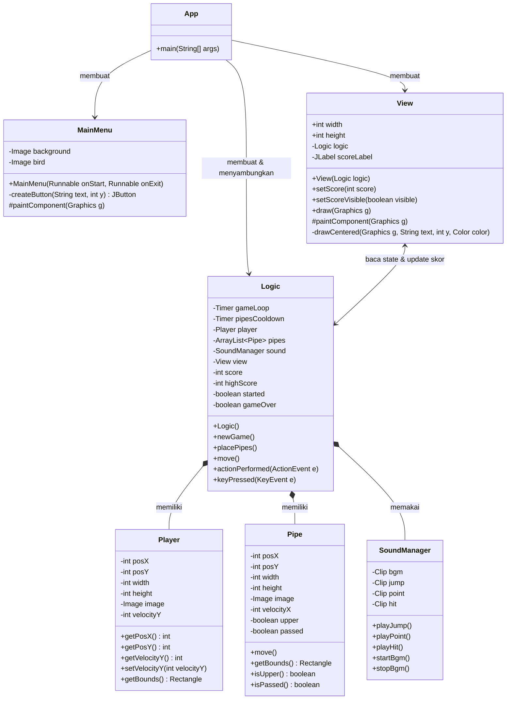

#  🐦  Flappy Bird - Java Swing GUI

Tugas Praktikum 6 - Desain dan Pemrograman Berorientasi Objek.
Flappy Bird dibuat dengan Java Swing (JFrame, JPanel, Timer, KeyListener).

## ❤️ Janji

Saya Jaka Permana Herawan dengan NIM 2509371 mengerjakan Tugas Praktikum 6 pada Mata Kuliah Desain dan 
Pemrograman Berorientasi Objek (DPBO) untuk keberkahan-Nya maka saya tidak melakukan kecurangan seperti yang telah dispesifikasikan. Aamiin

## ⌨️ Cara Menjalankan
1. Buka folder `FlappyBird` di IntelliJ IDEA (atau IDE Java lain).
2. Pastikan folder `src/assets` (gambar) dan `src/assets/sounds` (audio) ikut berada di source root.
3. Jalankan `App.java`.

## 📂 Struktur Folder

```text
TP6DPBO2526C2/
├── README.md
└── src/
    ├── App.java
    ├── MainMenu.java
    ├── View.java
    ├── Logic.java
    ├── Player.java
    ├── Pipe.java
    ├── SoundManager.java
    └── assets/
        ├── background.png
        ├── bird.png
        ├── upperPipe.png
        ├── lowerPipe.png
        └── sounds/
            ├── bgm.wav
            ├── jump.wav
            ├── point.wav
            └── hit.wav
```

## 📍 Kontrol
| Tombol | Fungsi |
|---|---|
| Tombol **MULAI** / **KELUAR** | Mulai permainan / tutup program |
| **Spasi** atau **↑** | Mulai (pertama kali) dan melompat |
| **R** | Restart setelah Game Over |
| **M** | Kembali ke Main Menu setelah Game Over |

## 🎨 Desain Program


> **Keterangan relasi:** `-->` asosiasi, `<-->` komunikasi dua arah, dan `◆` komposisi.
>
> `MainMenu` tidak memegang referensi ke `Logic`; aksi tombol MULAI/KELUAR dikirim oleh `App` sebagai `Runnable`. `View` dan `Logic` saling terhubung: `View` membaca state (termasuk mengambil `Player` dan `Pipe` lewat getter `Logic`) untuk menggambar, sedangkan `Logic` memperbarui skor dan meminta `repaint()`. `MainMenu` dan `View` merupakan turunan `JPanel`, sedangkan `Logic` mengimplementasikan `ActionListener` (Timer) dan `KeyListener` (keyboard).

| Class | Peran |
|---|---|
| `App` | Membuat JFrame, menyusun `MainMenu` dan `View` dengan CardLayout. |
| `MainMenu` | Layar awal dengan 2 tombol: MULAI dan KELUAR. |
| `View` | Kanvas game (JPanel): menggambar background, pipa, player, overlay, dan memuat JLabel skor. |
| `Logic` | Otak game: Timer game loop, gravitasi, pergerakan pipa, tabrakan, skor, game over, restart, input keyboard. |
| `Player` | Data burung (posisi, ukuran, gambar, kecepatan vertikal) dan hitbox. |
| `Pipe` | Data pipa (posisi, kecepatan, penanda pipa atas dan sudah dilewati) dan hitbox. |
| `SoundManager` | Memuat dan memutar BGM serta sound effect (javax.sound.sampled). |

## ✨ Penjelasan Alur
1. `App` membuka jendela dan menampilkan **Main Menu**.
2. **MULAI** memindah layar ke game dan memanggil `Logic.newGame()`: posisi direset, skor 0, BGM diputar. Game menunggu tekanan **Spasi** pertama.
3. Spasi pertama memanggil `startGame()`: pipa pertama dibuat dan `pipesCooldown` memunculkan sepasang pipa baru tiap 1,5 detik (celah di tinggi acak).
4. `gameLoop` (60 FPS) memanggil `actionPerformed()`: `move()` menerapkan gravitasi ke player, menggeser pipa, mengecek skor dan tabrakan, lalu `view.repaint()`.
5. **Skor**: saat posisi X player melewati sisi kanan pipa atas, skor bertambah 1 dan `JLabel` diperbarui.
6. **Game Over** terjadi saat player menyentuh pipa atau jatuh ke batas bawah. Timer pipa dan BGM berhenti, efek tabrakan diputar, dan overlay Game Over muncul beserta skor terbaik.
7. **R** memanggil `newGame()` untuk mengulang. **M** kembali ke Main Menu.

## ✅️ Pemenuhan Spesifikasi
| Spesifikasi | Implementasi |
|---|---|
| Game Over saat menabrak pipa / jatuh | `Logic.move()` -> `endGame()` |
| Restart dengan tombol R | `Logic.keyPressed()` -> `newGame()` |
| JLabel skor | `View.scoreLabel` |
| Skor +1 tiap melewati pipa | `Logic.move()` |
| Main Menu 2 tombol | `MainMenu` (MULAI, KELUAR) |
| Bonus audio | `SoundManager` + `assets/sounds/*.wav` (BGM, lompat, skor, tabrakan) |

## 📷 Dokumentasi Program Dijalankan

